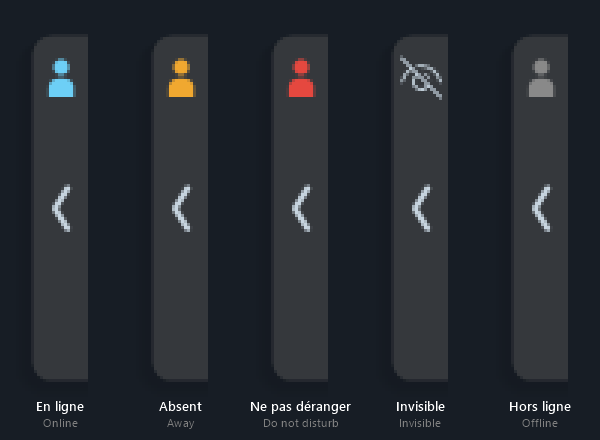
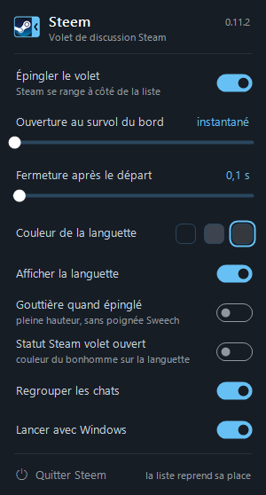
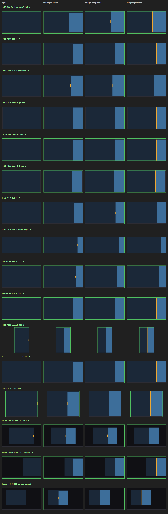

# Steem (for PC)

## 🇫🇷 L'événement du siècle.

L'humanité a marché sur la Lune, mais la liste de contacts de Steam vivait toujours dans une autre fenêtre. Avec Steem, **cette époque est révolue.**
Steam a enfin le droit à **une fenêtre inifiée.**

- 📌 Approche du bord droit : le volet s'ouvre. Un clic : c'est épinglé, Steam s'arrange.
- 💬 Nouveau message : le volet s'ouvre et la discussion a sa propre icône séparée.
- 🟦 Ton statut Steam d'un simple coup d'œil.
- ⚙️ Réglages dans l'icône près de l'horloge.

**Installer :** [Releases](../../releases) → `Steem_Setup_….exe` (complet, ~65 Mo) ou `…_leger.exe` (~2 Mo, .NET 8 requis).
Windows avertit (non signé) : « Informations complémentaires » › « Exécuter quand même ».

---

  
  &nbsp;&nbsp;
  

La languette affiche le statut Steam en cours · The tab shows your current Steam status · Die Lasche zeigt deinen aktuellen Steam-Status

---

## 🇬🇧 The event of the century.

Humanity walked on the Moon, yet Steam's friends list still lived in another window. **Not anymore.**
Steem docks it to Steam's right edge: **all in one window.**

- 📌 Approch the right edge : the panel opens. One click : pinned, Steam makes room.
- 💬 New message: the panel opens, the chat windows gets their own buttons in taskbar.
- 🟦 Your Steam status at a glance.
- ⚙️ Settings in the tray icon (interface in French for now).

**Install:** [Releases](../../releases) → `Steem_Setup_….exe` (full, ~65 MB) or `…_leger.exe` (~2 MB, needs .NET 8).
Windows warns (unsigned): "More info" › "Run anyway".

---

## 🇩🇪 Das Ereignis des Jahrhunderts.

Die Menschheit war auf dem Mond, doch die Steam-Freundesliste wohnte noch in einem eigenen Fenster. **Schluss damit.**
Steem dockt sie an den rechten Rand von Steam: **ein Fenster.**

- 📌 Rechter Rand: die Leiste öffnet sich. Ein Klick: angeheftet, Steam macht Platz.
- 💬 Neue Nachricht: die Leiste öffnet sich, der Chat bekommt sein eigenes Symbol.
- 🟦 Dein Steam-Status auf einen Blick.
- ⚙️ Einstellungen im Symbol neben der Uhr (Oberfläche vorerst auf Französisch).

**Installieren:** [Releases](../../releases) → `Steem_Setup_….exe` (komplett, ~65 MB) oder `…_leger.exe` (~2 MB, .NET 8 nötig).
Windows warnt (nicht signiert): „Weitere Informationen“ › „Trotzdem ausführen“.

---

## ☕ Soutenir mon travail · Support my work

🇫🇷 Tout est gratuit, et le restera. Si Steem vous rend service, un café sur Ko-fi m'aide à continuer.
🇬🇧 Everything is free, and will stay free. If Steem helps you, a coffee on Ko-fi helps me keep going.

---

Ni affilié à Valve ni approuvé par Valve · Not affiliated with Valve · Nicht mit Valve verbunden. Steam est une marque de / is a trademark of / ist eine Marke der Valve Corporation.

🖥️ 16 écrans simulés / simulated screens / simulierte Bildschirme

